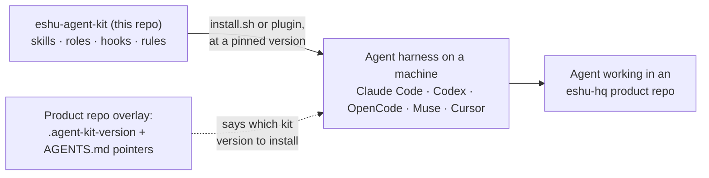

# eshu-agent-kit

**Status: v0.1.0** (the pinned release in [VERSION](VERSION)). Releases are SemVer git tags; a repo records the tag it uses in one pin file.

One shared kit of skills, subagent roles, hooks, and rules for every coding agent that works in eshu-hq repos — installed by version, never copy-pasted.

A *skill* is a written procedure an agent loads for a kind of task. A *hook* is a small script the agent tool (the *harness*, such as Claude Code or Codex) runs automatically at set moments, such as before an edit. A *subagent role* is a named helper-agent definition with its own instructions and model.

## What this is and why it exists

Without the kit, every repo carries its own copy of the same skills and hooks. Copies drift. Fixes land in one repo and never reach the others. Nobody knows which copy is current.

With the kit, product repos stay thin: a version pin plus a small overlay. Everything shared lives here and ships by version.

|  | Before | After |
| --- | --- | --- |
| Skills | Copied per repo, drifted | `install.sh --repo` symlinks them from the kit |
| Hooks | Wired by hand, half missing | The Claude Code plugin registers them, or one installer command links the scripts |
| Fixes | Patched once per repo | Patched once here; repos re-run the installer |
| Versions | "Which copy?" | `.agent-kit-version` in the repo says exactly |

## Where it fits



In words: this repo is the single source of shared agent material. The installer (or the Claude Code plugin) links it into whichever harness you run, at the version your repo pins. The kit itself runs no service and stores no Eshu data.

## Install

Claude Code, as a versioned marketplace plugin (skills plus automatic hook registration):

```sh
claude plugin marketplace add eshu-hq/eshu-agent-kit
claude plugin install eshu-agent-kit@eshu-agent-kit
```

Or inside Claude Code: `/plugin install eshu-agent-kit --marketplace eshu-hq/eshu-agent-kit`

Any harness, with the installer script (symlinks, so kit updates flow through on re-run):

```sh
./install.sh --global                    # this machine: skills + agents, all harnesses
./install.sh --global claude codex       # or pick: claude, codex, opencode, muse, cursor, all
./install.sh --agents --global opencode  # agents only, for the picked harnesses
./install.sh --repo /path/to/repo        # skills into one repo + writes its version pin
./install.sh --hooks --repo /path/to/repo  # hook scripts only; wiring stays explicit
./install.sh --rules --repo /path/to/repo  # Claude Code path-scoped rules + rules lint
```

How the installer behaves, from [install.sh](install.sh):

- Global mode links skills into each picked harness's skill directory and writes that harness's agent files. It asks for one model ID per agent (plus the OpenCode main model); pressing Enter, or any non-interactive run, keeps the kit default from [agents/roles.json](agents/roles.json).
- For OpenCode, model choices are merged into `~/.config/opencode/opencode.jsonc` so they win over per-file defaults. The merge tolerates comments and trailing commas; a file it cannot parse is left untouched and the installer exits nonzero. Other harnesses keep the model in each agent file.
- Existing non-symlink skill paths are preserved and each collision is reported; resolve those paths by hand if you want the kit version.
- Repo mode never prompts. `--repo` also writes the kit's [VERSION](VERSION) into the target repo as `.agent-kit-version`.

## What you get

Counts taken from this tree (skill folders each holding a `SKILL.md`, roles in `agents/roles.json`, hook scripts registered in `hooks/hooks.json`, rule files and docs excluding their index files):

|  | Count | Lives in | Loads via |
| --- | --- | --- | --- |
| Skills | 21 | `skills/eshu/` | Claude Code plugin, or `install.sh` on any harness |
| Subagent roles | 10 | `agents/` (source: `agents/roles.json`) | `install.sh --agents` |
| Hooks | 8 | `hooks/` | Plugin via `hooks/hooks.json`, or `install.sh --hooks` plus manual wiring |
| Path-scoped rules | 12 | `rules/` | `install.sh --rules` (Claude Code) |
| Process docs | 16 | `docs/eshu/` | Linked from the skills that cite them |

Today all 21 skills live in `skills/eshu/`: they are written for Eshu-family repos (graph, queue, and collector contracts). `skills/core/` exists but is empty — a skill moves there only after it passes the portability tests in [skills/registry.md](skills/registry.md), which is also the rename and layer map. Do not assume a generically named skill is portable; check the registry.

## When to use it, and when not to

Use the kit when an agent works in an eshu-hq repo and should follow the shared procedures: driving an issue to a merged PR, reviewing code to the shared bar, keeping long sessions resumable, and obeying hook-enforced guardrails.

Do not copy kit files into a product repo, and do not treat the `skills/eshu/` procedures as generic advice for unrelated codebases — they cite Eshu surfaces by design. Product repos pin a version and run the installer; that is the whole integration.

## How it works

The loop the kit exists for: the owner declares a goal against a GitHub epic or issue, and the kit drives it to a merged PR.

```text
GitHub epic / issue
        |
        v
issue-driver -- posts a claim, opens one worktree per leaf,
        |        implements with proof, opens the PR
        v
code-review -- verdict on the diff: blocking findings must be zero to merge
        |
        v
session-lifecycle (babysit) -- watches CI, fixes findings,
        |                        rebases, re-verifies, repeats
        v
PR merged -- issue closed, worktree cleaned
```

Three pieces carry the weight:

- **issue-driver** owns the outcome, not just the edit. It enumerates an epic's leaf issues, claims one publicly so concurrent agents do not collide, works each leaf in its own worktree with focused proof, and keeps going past "PR opened" through review and CI to merged or closed.
- **session-lifecycle** owns the mechanics long goals die without: resuming a branch mid-flight, pausing with a note and picking it up after compaction or days offline, judging whether a worker is alive before touching its tree, rebasing when `main` moves, and cleaning up at the end.
- **Hooks** own enforcement at the exact point of action — no prose reminders:

```text
Edit   -> skill-nudge: governed file? governing skill loaded? -> allow / BLOCK
Bash   -> guard-live-gate: second live gate running?          -> allow / BLOCK
Edit   -> doc-staleness: rebuild drift snapshot (signals only, never blocks)
Stop   -> goal-continue: goal unfinished? -> hand the goal back / allow end
Prompt -> goal-refresh: restate the goal ... SessionStart -> on-compact: restore
```

Every hook fails open outside its scope — a missing interpreter, a non-Eshu checkout, or no goal file all allow the action. A hook that cannot read its input has no basis to refuse anything. [hooks/README.md](hooks/README.md) has the full table and wiring.

`publish` is the last pass: issue bodies, PR descriptions, and status notes written so the next reader needs no other context.

## Harnesses

[install.sh](install.sh) supports five harnesses by name: `claude`, `codex`, `opencode`, `muse`, and `cursor` (or `all`; no name means all). Support is not identical on each:

- **Claude Code** gets the most: the marketplace plugin carries the skills and registers all 8 hooks automatically, and the path-scoped rules are Claude-specific. Installing the plugin never breaks an unrelated repo, because every hook fails open outside its scope.
- **Codex, OpenCode, Muse, and Cursor** get skills and subagent roles through the installer. Hook scripts need separate installation and explicit registration; see [hooks/README.md](hooks/README.md) for which adapters exist (for example the two Codex adapters in `hooks/codex/`).

Subagent roles ship through the installer on every harness. Their source of truth is [agents/roles.json](agents/roles.json); `agents/agent-roles.py generate` renders the per-harness mirror files (10 in each harness agent directory) and `check` fails on drift.

## Configuration

- `.agent-kit-version` in a product repo: one line, the kit tag that repo installs. Upgrade by moving the pin and re-running the installer.
- [agents/roles.json](agents/roles.json): the 10 role definitions and the default model per role tier, per harness.
- Model choices made during `--global` installs land in each agent file, or in `~/.config/opencode/opencode.jsonc` for OpenCode, as described under Install.

## Deploy / run

There is nothing to deploy and no service to run. The kit is files: markdown, JSON, and shell/Python scripts that an installer links into a harness or a repo checkout.

## Repo overlay

Everything a product repo keeps lives in [templates/repo-overlay/](templates/repo-overlay/): the version pin and a pointer-style `AGENTS.md`. Copy both, set the pin, run the installer. Details in [its README](templates/repo-overlay/README.md).

## Eshu dependencies

| Direction | Dependency | Notes |
| --- | --- | --- |
| This repo → runtime | `bash` and `python3` | Hooks are plain bash + python3 scripts ([hooks/README.md](hooks/README.md)); the installer is bash and uses python3 for the OpenCode config merge. There is no `go.mod`, `Dockerfile`, or `Makefile` in this repo. |
| This repo → Eshu services | None at run time | The kit contains procedures *about* Eshu repos; it calls no Eshu API and reads no Eshu database. |
| Eshu repos → this repo | Pinned kit version per repo | Each product repo's `.agent-kit-version` plus its overlay ([templates/repo-overlay/](templates/repo-overlay/)) is the integration point. |

## Development

CI runs only the lanes a PR can affect, and `ci-complete` is the one required check. Run the lanes locally before pushing (from [CONTRIBUTING.md](CONTRIBUTING.md)):

```sh
shellcheck --severity=error $(git ls-files '*.sh')   # shell lane (+ shfmt --diff)
bash scripts/run-tests.sh                            # shell-tests lane
bash scripts/check-docs-stale.sh --all && test ! -s .eshu-doc-state/stale.jsonl
bash scripts/check-md-links.sh                       # docs lane, with the line above
bash scripts/layer-lint.sh                           # docs lane
```

Keep shared material portable first, keep every file under 500 lines, and keep one meaning in one place — the full repo rules are in [AGENTS.md](AGENTS.md).

## Docs and related repos

- [hooks/README.md](hooks/README.md) — every hook, its trigger, and the manual wiring blocks.
- [rules/README.md](rules/README.md) — the rules contract and lint.
- [docs/eshu/README.md](docs/eshu/README.md) — the vendored process docs and their sync rule.
- [skills/registry.md](skills/registry.md) — rename map and the portability tests for `skills/core/`.
- Product repos under `eshu-hq` consume this kit through their overlay pin; Eshu core is where most `skills/eshu/` procedures apply.

## Contributing and license

See [CONTRIBUTING.md](CONTRIBUTING.md) for lanes and proof expectations. This tree contains no `LICENSE` or `SECURITY.md` file; do not assume license terms that are not written here.
