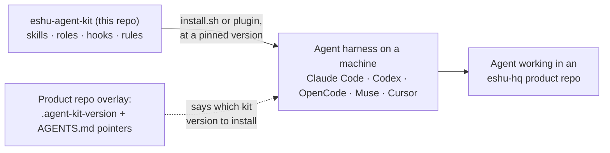

# eshu-agent-kit

Status: v0.1.0, the pinned release in [VERSION](VERSION). Releases are
SemVer git tags, and a repo records the tag it uses in one pin file.

This is one shared kit of skills, subagent roles, hooks, and rules for
every coding agent that works in eshu-hq repos. You install it by
version instead of copy-pasting it into each repo. A few terms, before
they show up below: a skill is a written procedure an agent loads for a
kind of task. A hook is a small script the agent tool (the harness, such
as Claude Code or Codex) runs on its own at set moments, like before an
edit. A subagent role is a named helper-agent definition with its own
instructions and model.



This repo is the single source of shared agent material, and the
installer (or the Claude Code plugin) links it into whichever harness
you run, at the version your repo pins. The kit runs no service and
stores no Eshu data.

## When it fits, and when it doesn't

Use the kit when an agent works in an eshu-hq repo and should follow the
shared procedures: driving an issue to a merged PR, reviewing code to the
shared bar, keeping long sessions resumable, and living with
hook-enforced guardrails.

Don't copy kit files into a product repo, and don't treat the
`skills/eshu/` procedures as generic advice for unrelated codebases.
They cite Eshu surfaces by design. Pin a version, run the installer,
and that's the whole integration.

## Shortest path in

On Claude Code, install it as a versioned marketplace plugin. That gets
you the skills plus automatic hook registration:

```sh
claude plugin marketplace add eshu-hq/eshu-agent-kit
claude plugin install eshu-agent-kit@eshu-agent-kit
```

On any harness, use the installer script instead. It symlinks, so kit
updates flow through when you re-run it:

```sh
./install.sh --global              # this machine: skills + agents, all harnesses
./install.sh --repo /path/to/repo  # skills into one repo + writes its version pin
```

[Install and configure](docs/guides/install-and-configure.md) covers
the other modes (`--agents`, `--hooks`, `--rules`), the model prompts,
and what happens when a path is already taken.
[Concepts](docs/concepts/README.md) explains the loop the kit exists
for, and [Reference](docs/reference/README.md) counts what you get.

## Documentation

| Doc | What's in it |
| --- | --- |
| [Docs index](docs/README.md) | Every docs section, grouped |
| [Getting started](docs/getting-started/README.md) | Plugin or installer, and your first run |
| [Guides](docs/guides/README.md) | Every installer mode, model choices, and pinning a product repo |
| [Concepts](docs/concepts/README.md) | The task-to-merged-PR loop, hooks, and the boundaries |
| [Reference](docs/reference/README.md) | What you get (counted) and how support differs per harness |
| [Diagrams](docs/diagrams/README.md) | Every diagram, each with a plain-text version |
| [Hooks](hooks/README.md) | Every hook, its trigger, and the manual wiring blocks |
| [Rules](rules/README.md) | The path-scoped rules contract and its lint |
| [Vendored process docs](docs/eshu/README.md) | The process docs the skills link to, mirrored from Eshu, with their sync rule |
| [Skill registry](skills/registry.md) | The rename and layer map, plus the portability tests a skill passes before it can move to `skills/core/` |
| [Repo overlay template](templates/repo-overlay/README.md) | The pin and pointer files a product repo copies in |
| [Contributing](CONTRIBUTING.md) | CI lanes and what proof a change needs |

## Related repos

Product repos under `eshu-hq` use this kit through their overlay pin.
Eshu core is where most `skills/eshu/` procedures apply, and it's still
the source for the vendored docs under `docs/eshu/`.

## Development

CI runs only the lanes a PR can affect, and `ci-complete` is the one
required check. You can run the lanes locally first with the commands in
[CONTRIBUTING.md](CONTRIBUTING.md), things like
`bash scripts/run-tests.sh` and `bash scripts/check-md-links.sh`.

## Contributing, security, and licence

See [CONTRIBUTING.md](CONTRIBUTING.md) for lanes and proof expectations.
There's no `LICENSE` or `SECURITY.md` in this tree, so don't assume
licence terms that aren't written down here.
