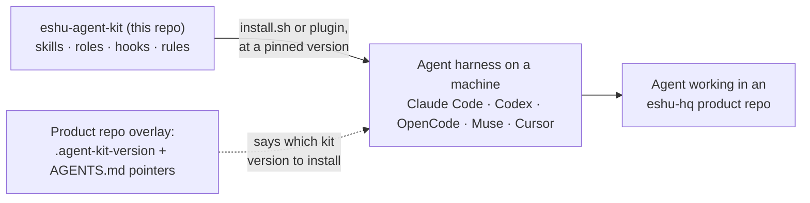
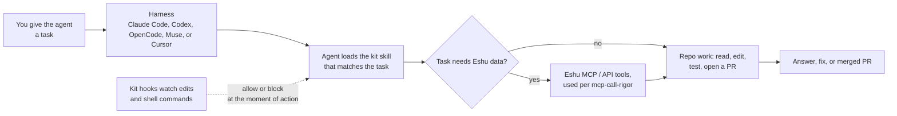
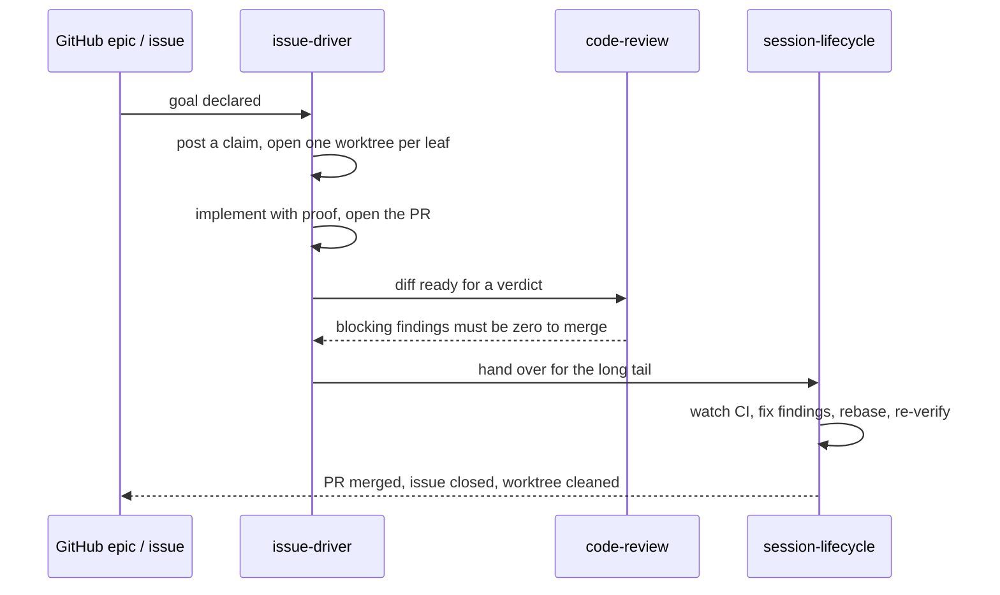

# Diagrams

Every diagram for eshu-agent-kit lives on this page. Other pages link
here instead of embedding their own copies. The repo
[README](../../README.md) keeps the first diagram only.

## Where the kit sits

This repo is the single source of shared agent material, and the
installer (or the Claude Code plugin) links it into whichever harness
you run, at the version your repo pins.

Text version: The kit (skills, roles, hooks, rules) installs via
`install.sh` or the plugin, at a pinned version, into the agent
harness on a machine. The harness runs the agent in an eshu-hq product
repo. The repo's overlay (`.agent-kit-version` + `AGENTS.md` pointers)
says which kit version to install.

## From a task to an answer

You hand the harness a task; the agent loads the kit skill that fits;
hooks allow or block actions as they happen.

Text version: Task → harness → agent loads matching skill. If the task
needs Eshu data, the agent uses Eshu MCP/API tools (per
`mcp-call-rigor`), then does repo work; otherwise it goes straight to
repo work. Output is an answer, fix, or merged PR. Throughout, kit
hooks watch edits and shell commands and allow or block at the moment
of action.

## The task-to-merged-PR loop

`issue-driver` owns the outcome, review gives the verdict, and
`session-lifecycle` carries the PR through CI and review rounds until
it merges or closes. Nothing stops at "PR opened".

Text version: (1) Goal declared on a GitHub epic/issue. (2)
`issue-driver` posts a claim and opens one worktree per leaf issue.
(3) It implements with proof and opens the PR. (4) `code-review`
verdicts — blocking findings must be zero to merge. (5)
`session-lifecycle` watches CI, fixes findings, rebases, re-verifies.
(6) PR merged, issue closed, worktree cleaned.
